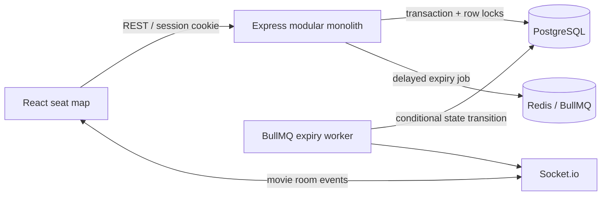

# CineLock

CineLock is a React and JavaScript movie ticket demo backed by Node.js, Express, PostgreSQL, Prisma, Redis, BullMQ, and Socket.io. PostgreSQL is the source of truth for seat inventory and reservation state; Prisma is the database client and model layer.

## Run locally

Requirements: Node.js 20+, Docker Desktop, and npm.

```powershell
Copy-Item .env.example .env
# Change JWT_SECRET and ADMIN_PASSWORD in .env before provisioning the admin.
docker compose up -d
npm install
npm run db:migrate
npm run db:seed
npm run dev
```

Open http://localhost:5173. The API listens on http://localhost:4000. Admin credentials come from `ADMIN_EMAIL` and `ADMIN_PASSWORD` in `.env`; registration always creates a regular user. Never use the sample password in a shared environment.

## Architecture and invariants

The backend uses an MVC-style layout. Prisma's `schema.prisma` defines the models; route files connect URLs and middleware to controllers; controllers handle HTTP input/output; services contain business rules and transactional work.

```text
server/
  prisma/schema.prisma           # Prisma model definitions
  src/
    app.js                       # Express setup and centralized errors
    routes/apiRoutes.js          # API URL map
    controllers/                 # Authentication, movie, reservation handlers
    reservations.js              # Reservation, payment, expiry transaction logic
    auth.js                      # Authentication and role middleware
    db.js                        # Shared Prisma client and transaction helper
    seatEvents.js                # Socket notification callback
    queue.js                     # BullMQ expiry worker and queue
  tests/
    integration/                 # Vitest checks against PostgreSQL
    load/                        # k6 HTTP load tests
```



`server/prisma/schema.prisma` is the model definition: `User`, `Movie`, `Seat`, `ShowSeat`, `Reservation`, `ReservationSeat`, and `Payment` map to PostgreSQL tables. Prisma migrations live in `server/prisma/migrations/`; the initial migration also adds database check constraints that Prisma's schema language does not express. Normal reads and writes use generated Prisma model methods. The reservation service uses parameterized PostgreSQL SQL through Prisma only for `SELECT ... FOR UPDATE` and server-clock checks, because the booking guarantee depends on those row locks.

### How to read `reservations.js`

Start at `reserve()`. It coordinates the steps and delegates the details to named helpers:

1. Look for an existing reservation with the same idempotency key.
2. Lock relevant active reservations, then lock all requested seat rows in a stable order.
3. Reclaim rows only when their existing hold has expired.
4. Reject the entire request if any requested seat remains unavailable.
5. Create the reservation, connect every seat, and mark them `HELD` inside one Prisma transaction.
6. After the transaction commits, publish the Socket.io update and enqueue expiry.

Then read `pay()`: it locks the reservation, checks ownership and the deadline, locks its seat rows, and confirms the booking plus simulated payment atomically. `expireReservation()` is the worker path; it changes state only if the reservation is still active and expired, then releases seats only if they still point to that reservation. `transaction()` in `db.js` wraps each callback in Prisma's interactive transaction; an error rolls all its database changes back.

Movies each receive a 100-row seat inventory using the shared A1–J10 seat definitions. Reservation requests validate the entire input, acquire all requested `show_seats` rows in stable ID order with `FOR UPDATE`, check availability while locks are held, and update every seat in one Prisma transaction. PostgreSQL therefore serializes requests that overlap while disjoint row sets can proceed independently. A conflict rolls back all changes. The database unique constraints also enforce one inventory row per movie/seat, one reservation per user/idempotency key, and one payment per reservation.

Reservations last five minutes. Redis schedules cleanup, but both reservation and Pay operations check expiry against server/database state. Expiry updates only seats still held by that reservation. Pay locks the reservation and then its seats, checks the deadline and ownership, and atomically confirms the reservation, books the seats, and records a simulated payment. Repeated Pay calls return the existing booking reference. Socket.io events are emitted after successful commits; clients refresh authoritative inventory on connection/reconnection. A transactional outbox is not included in this first version, so a process crash between commit and event emit can delay a live update until refresh/reconnect; it cannot affect booking correctness.

Authentication uses bcrypt password hashes and an HTTP-only SameSite cookie containing a signed JWT. Admin routes require the server-side ADMIN role. Users can only read/pay their own reservations. Payment details are never collected.

## API overview

- `POST /api/auth/register`, `POST /api/auth/login`, `POST /api/auth/logout`, `GET /api/auth/me`
- `GET /api/movies`, `POST /api/movies` (admin only), `GET /api/movies/:id/seats`
- `POST /api/movies/:id/reservations` with `{seatIds,idempotencyKey}`
- `GET /api/my/reservations`, `GET /api/reservations/:id`, `POST /api/reservations/:id/pay`
- `GET /api/health`

Errors use JSON `{error}` responses, with 400 for invalid input, 401 for unauthenticated requests, 403 for non-admin access, 404 for inaccessible reservations, 409 for unavailable seats, and 410 for expired reservations.

## Configuration

See `.env.example`: `DATABASE_URL`, `REDIS_URL`, `JWT_SECRET`, `PORT`, `WEB_ORIGIN`, `ADMIN_NAME`, `ADMIN_EMAIL`, and `ADMIN_PASSWORD`. The seed provisions an admin only if the email is not already present.

After changing `schema.prisma`, create a migration during development with `npm run db:migration:create -w server -- --name describe_change`, then apply it with `npm run db:migrate`. `npm run db:generate` regenerates the Prisma JavaScript client. For a disposable local database only, Prisma Studio can inspect the tables with `npx prisma studio --schema server/prisma/schema.prisma`.

## Build and verification

```powershell
npm run build
npm test
```

The Vitest integration tests require a migrated test database and run with `npm test`. The k6 load test is separate and requires the k6 CLI. Set `BASE_URL`, `EMAIL`, `PASSWORD`, and `MOVIE_ID`, then run `npm run test:load` (optionally set `VUS`, `DURATION`, and `SEAT_IDS`; seats default to `A1,A2`). k6 reports throughput and p95 latency; `reservation_conflicts` counts expected conflicts. Use a fresh movie inventory for repeatable runs. Add a disjoint-seat workload separately when measuring independent lock throughput. No performance claim is made until a run has been measured.
