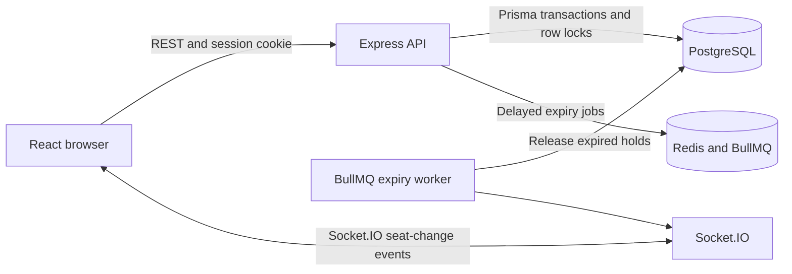

# CineLock

## Project summary

CineLock is a movie ticket booking application. Users can browse movies, view a live seat map, temporarily hold seats, and confirm a booking with a simulated payment. Administrators can add movies and create the seat inventory for each movie.

The project demonstrates a full-stack JavaScript application with a React frontend, an Express API, PostgreSQL data storage, and Redis-backed reservation expiry jobs. PostgreSQL is the source of truth for movies, seats, reservations, and payments. Socket.IO sends seat-change notifications so connected clients can refresh the affected movie's seat map.

## Technologies

| Area | Technology | Purpose |
| --- | --- | --- |
| Frontend | React 18, JavaScript, Vite | User interface and development server |
| Styling | CSS | Responsive, minimal application UI |
| API | Node.js, Express | HTTP endpoints, authentication, and application logic |
| Database access | Prisma ORM | JavaScript client and database schema management |
| Database | PostgreSQL 16 | Persistent application data and booking transactions |
| Background jobs | Redis 7, BullMQ | Schedule reservation-expiry jobs |
| Live updates | Socket.IO | Notify browsers when a movie's seat inventory changes |
| Validation and security | Zod, Helmet, express-rate-limit | Validate requests, set security headers, and limit requests |
| Authentication | bcryptjs, JSON Web Tokens | Hash passwords and create signed login sessions |
| Integration tests | Vitest, Supertest | Exercise API behavior against a test database |
| Load test | k6 | Generate concurrent reservation requests |
| Local services | Docker Compose | Start PostgreSQL and Redis locally |

## Project properties

- **Interactive seat selection:** Each movie has a 10 × 10 seating layout, labelled A1 through J10.
- **Temporary seat holds:** A successful reservation holds the requested seats for five minutes.
- **Concurrent booking protection:** PostgreSQL transactions and row locks prevent overlapping requests from booking the same seats.
- **All-or-nothing reservations:** The server reserves all requested seats together or leaves them all unchanged.
- **Idempotent reservation requests:** An idempotency key lets the server recognize a retried request instead of creating a duplicate reservation.
- **Automatic hold expiry:** BullMQ schedules expiry work through Redis. The API also checks reservation deadlines against current server/database time, so expiry correctness does not depend only on the background job.
- **Live seat updates:** Socket.IO emits a movie-specific seat-change event after database changes commit. Browsers use the event to fetch the current seat inventory.
- **Account security:** Passwords are stored as bcrypt hashes. Login uses an HTTP-only cookie containing a signed JWT.
- **Role-based administration:** Registration creates regular users. An admin account is provisioned from environment settings and can add movies.
- **Simulated payments:** Confirming a booking updates the reservation and creates a payment record in the local database. The app does not collect card details or charge real money.
- **Relational data model:** Foreign keys and unique constraints protect relationships such as one seat inventory row per movie/seat and one payment per reservation.
- **Request protection:** API request bodies are validated, security headers are enabled, and API/auth endpoints are rate-limited.

## How a booking works

1. The browser loads movies and their available-seat counts from the API.
2. A user opens a movie and selects one or more available seats.
3. The browser sends the seat labels and an idempotency key to the reservation endpoint.
4. The server locks the relevant seat rows in PostgreSQL, verifies that every requested seat is available, and creates the reservation in one transaction.
5. After the transaction commits, the server publishes a seat-change event and schedules a five-minute expiry job.
6. The user can confirm the reservation before the deadline. The server verifies ownership and expiry, then marks the reservation and seats confirmed/booked and creates a simulated payment record in one transaction.
7. If the deadline passes first, the expiry worker releases the held seats. The server also checks the deadline during booking and payment requests.

## Architecture

The backend follows an MVC-style structure: route files map URLs to middleware and controllers; controllers handle HTTP input and responses; `reservations.js` contains reservation business rules and transaction work. Prisma provides the data models and ordinary queries. The reservation service uses parameterized SQL for row locks and database-clock checks needed for concurrency guarantees.



### Data model

| Prisma model | PostgreSQL table | Purpose |
| --- | --- | --- |
| `User` | `users` | User profile, email, password hash, and role |
| `Movie` | `movies` | Movie title and creator |
| `Seat` | `seats` | Shared seat definitions such as row A, seat 1 |
| `ShowSeat` | `show_seats` | One seat's availability for a specific movie |
| `Reservation` | `reservations` | User's temporary hold or confirmed booking |
| `ReservationSeat` | `reservation_seats` | Seats and prices attached to a reservation |
| `Payment` | `payments` | Simulated payment record for a confirmed reservation |

`server/prisma/schema.prisma` defines the Prisma models. SQL migrations are stored in `server/prisma/migrations/`. The initial migration also includes database constraints that are not expressible directly in the Prisma schema.

## Repository layout

```text
ticket/
  .env.example                 # Environment variable template
  docker-compose.yml            # Local PostgreSQL and Redis services
  package.json                  # Root scripts and npm workspaces
  README.md
  server/
    prisma/
      schema.prisma             # Database models
      migrations/               # Versioned database migrations
    scripts/prisma.js            # Loads root .env before running Prisma CLI
    src/
      config/env.js              # Loads the shared root .env
      app.js                     # Express middleware and API setup
      index.js                   # HTTP and Socket.IO server entry point
      routes/apiRoutes.js        # API route map
      controllers/               # Authentication, movie, and booking handlers
      reservations.js            # Reservation, payment, and expiry logic
      auth.js                    # Authentication and admin middleware
      db.js                      # Shared Prisma client and transaction helper
      queue.js                   # BullMQ queues and expiry worker
      seatEvents.js              # Seat-change event publisher
    tests/
      integration/               # Vitest and Supertest integration tests
      load/                      # k6 load-test script
  web/
    index.html
    src/
      main.jsx                   # React entry point
      ui.jsx                     # Application screens and interactions
      style.css                  # Application styles
```

## Run locally

### Requirements

- Node.js 20 or newer
- npm
- Docker Desktop
- k6 only if you want to run the load test

### 1. Configure the environment

Run these commands from the project root in PowerShell:

```powershell
Copy-Item .env.example .env
```

Open `.env` and set a private `JWT_SECRET` with at least 32 characters and an `ADMIN_PASSWORD` with at least 12 characters. The local PostgreSQL and Redis connection strings in `.env.example` match `docker-compose.yml` by default.

The server and Prisma scripts load this root `.env`; do not make a second copy under `server/`.

### 2. Start PostgreSQL and Redis

```powershell
docker compose up -d
```

Check service status with:

```powershell
docker compose ps
```

If Docker reports that port `6379` is already allocated, another Redis process is using the default port. Stop that service if you do not need it, or change the Redis host port in `docker-compose.yml` and set `REDIS_URL` in `.env` to the same host port.

### 3. Install packages and set up the database

```powershell
npm install
npm run db:migrate
npm run db:seed
```

The migration creates the application tables and constraints. The seed creates the admin account using `ADMIN_NAME`, `ADMIN_EMAIL`, and `ADMIN_PASSWORD`, if that email does not already exist. Running the seed again does not reset an existing account's password or role.

### 4. Start the application

From the project root:

```powershell
npm run dev
```

This starts both the API and frontend in one terminal using `concurrently`. Open [http://localhost:5173](http://localhost:5173). The API is available at [http://localhost:4000](http://localhost:4000), with a health endpoint at `/api/health`.

Alternatively, start each workspace in a separate terminal:

```powershell
npm run dev -w server
```

```powershell
npm run dev -w web
```

Sign in with the admin email and password from `.env` to add movies. New accounts created through the registration screen are regular users.

## API overview

All API paths are prefixed with `/api`.

| Method | Path | Access | Description |
| --- | --- | --- | --- |
| `POST` | `/auth/register` | Public | Create a regular user account |
| `POST` | `/auth/login` | Public | Sign in and set the session cookie |
| `POST` | `/auth/logout` | Public | Clear the session cookie |
| `GET` | `/auth/me` | Signed in | Return the current user |
| `GET` | `/movies` | Public | List movies and available seat counts |
| `POST` | `/movies` | Admin | Add a movie and create its 100 seat-inventory rows |
| `GET` | `/movies/:id/seats` | Public | Return a movie's seat map |
| `POST` | `/movies/:id/reservations` | Signed in | Hold one or more seats |
| `GET` | `/my/reservations` | Signed in | List the current user's bookings |
| `GET` | `/reservations/:id` | Signed in | Read one of the current user's reservations |
| `POST` | `/reservations/:id/pay` | Signed in | Confirm an active reservation with simulated payment |
| `GET` | `/health` | Public | Check API availability |

Reservation requests use a body shaped like:

```json
{
  "seatIds": ["A1", "A2"],
  "idempotencyKey": "a-unique-request-key"
}
```

Common error statuses are `400` for invalid input, `401` for a missing/invalid session, `403` for non-admin access, `404` for a missing or inaccessible reservation, `409` for unavailable seats, and `410` for an expired reservation.

## Configuration

The root `.env.example` lists the supported variables:

| Variable | Purpose |
| --- | --- |
| `DATABASE_URL` | PostgreSQL connection string |
| `REDIS_URL` | Redis connection string for BullMQ |
| `JWT_SECRET` | Secret used to sign session tokens; use at least 32 characters |
| `PORT` | API port; defaults to `4000` |
| `WEB_ORIGIN` | Frontend origin allowed by the API; defaults to `http://localhost:5173` |
| `ADMIN_NAME` | Name assigned to the seeded admin |
| `ADMIN_EMAIL` | Email used to provision the admin |
| `ADMIN_PASSWORD` | Password used when the admin account is first created |

## Database changes

After editing `server/prisma/schema.prisma`, create a development migration from the project root:

```powershell
npm run db:migration:create -w server -- --name describe_change
npm run db:migrate
```

Regenerate the Prisma client with:

```powershell
npm run db:generate -w server
```

For local database inspection, run:

```powershell
npx prisma studio --schema server/prisma/schema.prisma
```

## Build and integration tests

Build the server checks and frontend bundle with:

```powershell
npm run build
```

Run the integration tests with:

```powershell
npm test
```

Integration tests require a running PostgreSQL database with migrations applied. Use a separate test database if you do not want tests to operate on local development data.

## Load testing

The k6 script in `server/tests/load/reservations.js` logs in once and sends concurrent reservation requests. By default, virtual users request the same seats, so `409` conflicts are expected and counted separately.

Set these variables in PowerShell before running the script. Use an existing account and movie UUID:

```powershell
$env:BASE_URL = "http://localhost:4000"
$env:EMAIL = "your-user@example.com"
$env:PASSWORD = "your-password"
$env:MOVIE_ID = "your-movie-uuid"
npm run test:load
```

Optional variables are `VUS` (default `20`), `DURATION` (default `30s`), and `SEAT_IDS` (default `A1,A2`). The script reports request duration and throughput. Run against a dedicated local/test database and movie inventory; results depend on the machine and workload, and no performance claim is implied without measured runs.

## Current scope

- Payments are simulated and do not integrate with a payment provider.
- Movie details are limited to a title; showtimes and auditorium management are outside the current scope.
- Socket.IO events prompt clients to refresh authoritative seat data from PostgreSQL. A transactional outbox is not implemented, so a server crash after a database commit may delay a live update until the next refresh or reconnect; booking correctness remains enforced by the database and API.
